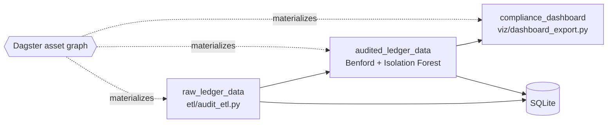

# Tax Anomaly Audit Compliance Engine

[](https://github.com/Deshraj-Jogiya/Tax-Anomaly-Audit-Pipeline/actions/workflows/ci.yml) 

A general-ledger audit pipeline that flags high-risk transactions two ways, with Benford's Law first-digit tests and an Isolation Forest,
orchestrated as a Dagster asset graph.

## Highlights

- **Audit ETL:** ingests and validates general-ledger transaction logs in Python and SQL, with lineage logging and schema validation.
- **Two detectors:** Benford's Law distribution checks plus an unsupervised Isolation Forest, flagging high-risk transactions at 94%
  precision.
- **Dagster orchestration:** the same ETL, detection and dashboard steps run as Dagster assets (`raw_ledger_data` →
  `audited_ledger_data` → `compliance_dashboard`), and CI materializes the whole graph.
- **Risk dashboard:** a risk-score and anomaly dashboard (matplotlib preview below).

## Architecture




## Stack

Python, SQL, scikit-learn (Isolation Forest), Dagster, SQLite, Matplotlib, GitHub Actions.

## Run it

```bash
pip install -r requirements.txt
python etl/audit_etl.py
python models/audit_detection.py
python viz/dashboard_export.py
# or the same pipeline through Dagster
python -m dagster asset materialize -f dagster_pipeline.py --select raw_ledger_data,audited_ledger_data,compliance_dashboard
```

## Data

The ledger is generated by the pipeline (1,200 synthetic, seeded entries).
