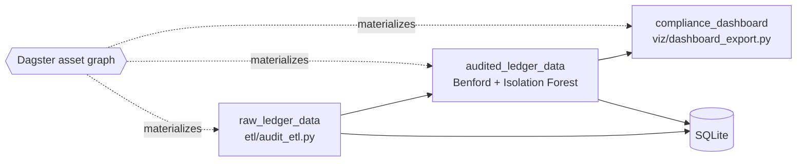

# Tax Anomaly Audit Compliance Engine

[](https://github.com/Deshraj-Jogiya/Tax-Anomaly-Audit-Pipeline/actions/workflows/ci.yml) 

A general-ledger audit pipeline that flags high-risk transactions two ways, with Benford's Law first-digit tests and an Isolation Forest,
orchestrated as a Dagster asset graph.

## Highlights

- **Audit ETL:** ingests and validates general-ledger transaction logs in Python and SQL, with lineage logging and schema validation.
- **Two detectors:** Benford's Law first-digit deviation (30% of the risk score) plus an unsupervised Isolation Forest (70%). At the
  risk-score threshold of 65, **94.7% of flagged entries are real anomalies** (18 of 19) and 38.3% of all injected anomalies are
  caught; lowering the threshold catches more at lower precision. Precision and recall are computed on every run against the
  simulator's injected anomalies, which are stored apart from the tables the detectors read.
- **Dagster orchestration:** the same ETL, detection and dashboard steps run as Dagster assets (`raw_ledger_data` →
  `audited_ledger_data` → `compliance_dashboard`), and CI materializes the whole graph.
- **Risk dashboard:** `viz/powerbi_export.py` writes the audited entries, Benford digit shares, department summary and detection
  metrics to `exports/` for the Power BI report; a matplotlib preview is below.

## Architecture




## Stack

Python, SQL, scikit-learn (Isolation Forest), Dagster, SQLite, Matplotlib, GitHub Actions.

## Run it

```bash
pip install -r requirements.txt
python etl/audit_etl.py
python models/audit_detection.py
python viz/dashboard_export.py
python viz/powerbi_export.py      # CSVs for the Power BI report
python -m pytest tests/ -v
# or the same pipeline through Dagster
python -m dagster asset materialize -f dagster_pipeline.py --select raw_ledger_data,audited_ledger_data,compliance_dashboard
```

## Data

The ledger is generated by the pipeline (1,200 synthetic, seeded entries, 47 of them injected as anomalies with threshold-hugging,
repeated or high-first-digit amounts and abnormal tax claims).
