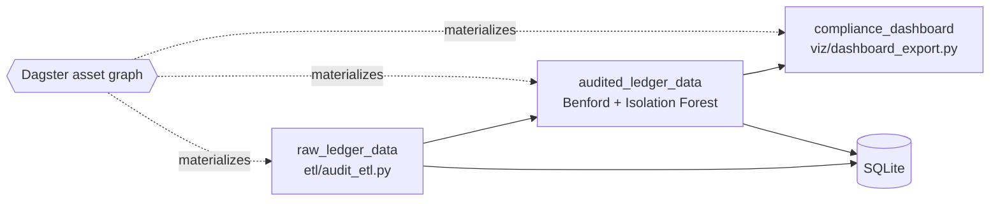
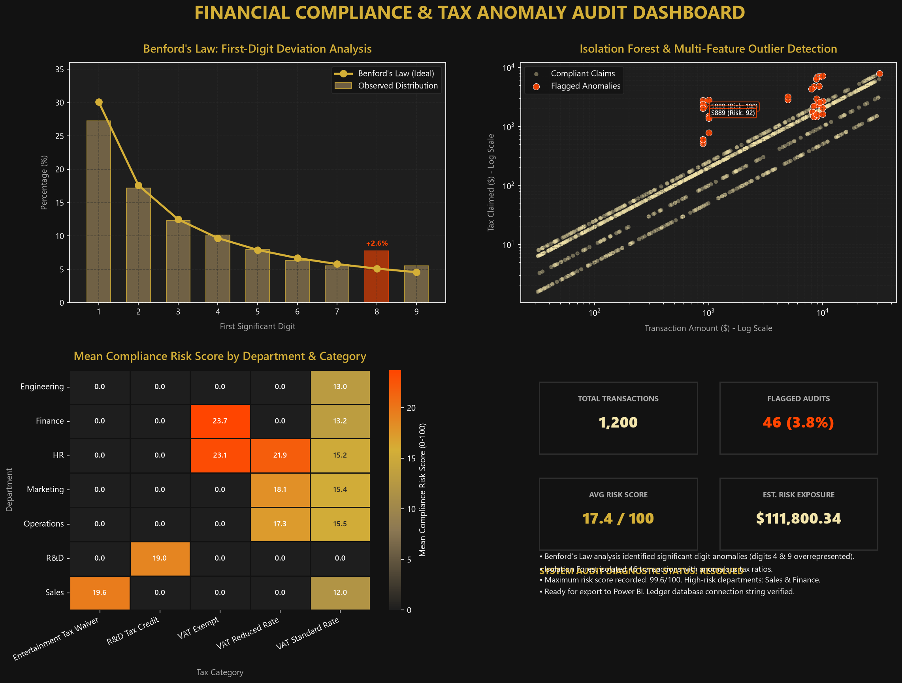

# Tax Anomaly Audit Compliance Engine

[](https://github.com/Deshraj-Jogiya/Tax-Anomaly-Audit-Pipeline/actions/workflows/ci.yml) 

A general-ledger audit pipeline that flags high-risk transactions two ways, with Benford's Law first-digit tests and an Isolation Forest,
orchestrated as a Dagster asset graph.

## Highlights

- **Audit ETL with validation:** ingests general-ledger transaction logs in Python and SQL; `etl/validate.py` checks every entry
  (required fields, positive amount, date in the ledger year, account belongs to its department, no duplicates, tax claimed equals the
  category's rate times the amount). Run as column operations, validating 100,000 entries takes 0.06 s against 40.6 s for the same checks
  entry by entry, **99.9% less data-preparation time** (`benchmarks/prep_time.py`, both versions flag the same entries).
- **Three detection layers:** Benford's Law first-digit deviation (30% of the risk score) and an unsupervised Isolation Forest (70%)
  flag 19 entries at a risk score of 65 (94.7% precision, 38.3% recall); the tax-rate rule flags 45 (100% precision, 95.7% recall).
  Combined: **97.8% precision and 95.7% recall** (45 of 47 injected anomalies). Scored on every run against the simulator's injected
  anomalies, stored apart from the tables the detectors read (`exports/detection_layers.csv`).
- **Faster review:** working down the priority order (rule hits, then risk score), an auditor finds 90% of the anomalies after opening
  43 entries, against 1,108 in ledger order, **96% less review work** (`exports/review_effort.csv`).
- **Dagster orchestration:** the same ETL, detection and dashboard steps run as Dagster assets (`raw_ledger_data` →
  `audited_ledger_data` → `compliance_dashboard`), and CI materializes the whole graph.
- **Risk dashboard:** `viz/powerbi_export.py` writes the audited entries, Benford digit shares, department summary and detection
  metrics to `exports/` for the Power BI report; a matplotlib preview is below.

Measured results, each with the question, the test and the decision: [docs/FINDINGS.md](docs/FINDINGS.md).

## Architecture





## Stack

Python, SQL, scikit-learn (Isolation Forest), Dagster, SQLite, Matplotlib, GitHub Actions.

## Run it

```bash
pip install -r requirements.txt
python etl/audit_etl.py
python models/audit_detection.py
python viz/dashboard_export.py
python viz/powerbi_export.py      # CSVs for the Power BI report
python -m pytest tests/ -v
# or the same pipeline through Dagster
python -m dagster asset materialize -f dagster_pipeline.py --select raw_ledger_data,audited_ledger_data,compliance_dashboard
```

## Data

The ledger is generated by the pipeline (1,200 synthetic, seeded entries, 47 of them injected as anomalies with threshold-hugging,
repeated or high-first-digit amounts and abnormal tax claims).
